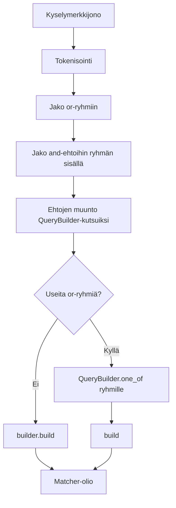

# NHL-kyselykieli

Kyselymerkkijonolla voi kuvata pelaajille tehtäviä ehtoja. `parse` palauttaa matcher-olion, jonka voi antaa esimerkiksi `Statistics.matches`-metodille.

```python
from query_parser import parse

matcher = parse("team = NYR and goals >= 10 and goals < 20")
matching_players = stats.matches(matcher)
```

## Tuettu syntaksi

Kyselyn ehto voi olla jokin seuraavista:

| Ehto | Esimerkki | Merkitys |
| --- | --- | --- |
| `team = <joukkue>` | `team = NYR` | Pelaajan joukkue on NYR. |
| `<attribuutti> >= <kokonaisluku>` | `goals >= 10` | Attribuutin arvo on vähintään 10. |
| `<attribuutti> < <kokonaisluku>` | `points < 50` | Attribuutin arvo on alle 50. |

Joukkue- ja attribuuttinimet ovat tunnisteita: ne alkavat kirjaimella tai alaviivalla, ja niiden jälkeen voi olla kirjaimia, numeroita tai alaviivoja. Kokonaisluku voi olla etumerkillinen, esimerkiksi `-2` tai `+10`. Attribuutin nimen olemassaolo tarkistuu vasta matcher-olion arvioinnissa.

Ehtoja voi yhdistää pienaakkosin kirjoitetuilla `and`- ja `or`-operaattoreilla:

```text
team = NYR and goals >= 10
team = PHI or team = EDM
team = PHI and assists >= 10 and goals < 10 or team = EDM and points >= 50
```

## Operaattorien sitovuus

`and` sitoo vahvemmin kuin `or`. Siksi viimeinen esimerkki tulkitaan näin:

```text
(team = PHI and assists >= 10 and goals < 10)
or
(team = EDM and points >= 50)
```

Sulkeita ei tueta kyselykielessä.

## Merkkijonosta matcher-olioksi

`parse` tokenisoi kyselyn ja käsittelee sen ensin `or`-ryhmiin. Jokainen ryhmä jaetaan edelleen `and`-ehdoiksi. Ehdot lisätään `QueryBuilder`-olioon sen nykyisillä metodeilla:

- `team = NYR` → `builder.plays_in("NYR")`
- `goals >= 10` → `builder.has_at_least(10, "goals")`
- `points < 50` → `builder.has_fewer_than(50, "points")`

Ryhmän ehdot ketjutetaan samaan builderiin. Jos kyselyssä on useampi `or`-ryhmä, ryhmien builderit yhdistetään `QueryBuilder().one_of(*queries)`-kutsulla. Lopuksi `build()` palauttaa matcher-olion. Jäsentäminen hyödyntää nykyistä `QueryBuilder`- ja matcher-logiikkaa; vertailu- tai yhdistämislogiikkaa ei toteuteta parserissa uudelleen.



Parserin palauttamaa oliota voi käyttää suoraan:

```python
matcher = parse("team = NYR and goals >= 10")
players = stats.matches(matcher)
```

## Virheelliset kyselyt

Jos kyselyssä on virheellinen rakenne, tuettuja merkkejä tai operaattoreita rikotaan tai ehdon arvon muoto ei kelpaa, `parse` nostaa `ValueError`-poikkeuksen. Esimerkiksi seuraavat kyselyt ovat virheellisiä:

```text
team =
goals > 10
goals >= ten
team = NYR and
```

Parseri ei tarkista, löytyykö attribuutti pelaajalta. Jos kysely viittaa tuntemattomaan attribuuttiin, matcher-olion arviointi voi nostaa `AttributeError`-poikkeuksen.

## Testit

Projektin juurihakemistossa testit ajetaan komennolla:

```sh
uv run python -m unittest discover -s tests -v
```

Parserin yksikkötestit käyttävät paikallista testidataa eivätkä tarvitse verkkoyhteyttä.
